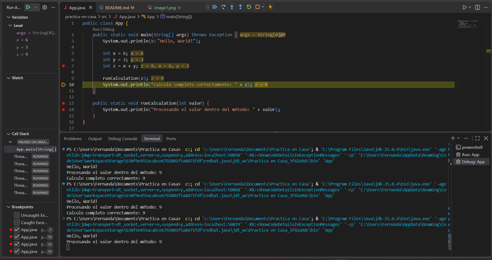

## Practica en casa 1
 

 09 de octubre del 2026

 Hoy cree una carpeta desde el cmd

 ## Practica en casa 2

 09 de octubre del 2026

 Cree un metodo y me mando mi primer resultado

 

 ## Problema 1

 09 de octubre del 2026
 
 Se encontre un problema de conexion, que se arregla con estos comandos en git:
 - git config --global --unset http.proxy

 ## Practica 3

 09 de octubre del 2026

 Cree mi primer metodo e hice un depurador

